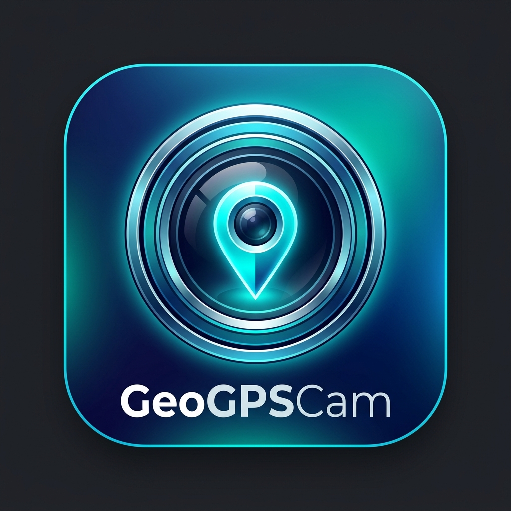

<p align="center">
  
</p>

<h1 align="center">GeoGPSCam 📸📍</h1>

<p align="center">
  <b>Aplikasi Kamera Flutter dengan Watermark GPS & Timestamp Real-time Presisi Tinggi</b>
</p>

<p align="center">
  
  
  
  
</p>

---

## 📌 Deskripsi

**GeoGPSCam** adalah aplikasi kamera berbasis **Flutter** yang dirancang untuk kebutuhan pendokumentasian lapangan, verifikasi lokasi kerja, inspeksi teknis, dan kegiatan outdoor. Aplikasi secara otomatis menyematkan watermark data geografis yang kaya langsung pada piksel gambar foto sebelum disimpan ke galeri perangkat.

### ✨ Fitur Utama

- 📸 **Kamera HD Real-time**: Menggunakan pustaka `camera` native dengan resolusi tinggi, kontrol flash, serta dukungan kamera depan & belakang.
- 📍 **GPS & Reverse Geocoding**: Mengambil koordinat Latitude & Longitude presisi 6 desimal secara offline/online serta otomatis mengonversi ke alamat lokasi lengkap (Jalan, Kelurahan, Kecamatan, Kota, Provinsi).
- 🕐 **Timestamp Real-time (id_ID)**: Menampilkan jam dan tanggal otomatis terformat standar Indonesia (contoh: *Rabu, 30 Juli 2026 13:28:05*).
- 🖼️ **Overlay Viewfinder Interactive**: Menampilkan estimasi watermark secara langsung pada layar kamera sebelum tombol jepret ditekan.
- 🎨 **Asynchronous Image Processing**: Menggunakan pustaka `image` Dart untuk menggabungkan watermark teks dan panel transparan secara jernih dan tanpa *lag* pada UI.
- 💾 **Ekspor Langsung ke Galeri**: Foto disimpan otomatis ke album media HP (*Gal*) dengan nama berkas unik berbasis timestamp.

---

## 🎨 Tampilan Layout Watermark

Watermark disematkan di bagian bawah foto dengan format panel modern dan mudah dibaca:

```text
┌────────────────────────────────────────────────────────────────────────┐
│                                                                        │
│                              [ FOTO ASLI ]                             │
│                                                                        │
├════════════════════════════════════════════════════════════════════════┤
│ 🕐 13:28:05                        🌐 LAT  -6.200000°                  │
│    Rabu, 30 Juli 2026                     LNG  106.816666°                 │
│                                                                        │
│ 📍 Jl. Jend. Sudirman No. 45, Tanah Abang, Jakarta Pusat               │
│                                                          GeoGPS Cam 📸 │
└────────────────────────────────────────────────────────────────────────┘
```

---

## 📂 Struktur Proyek

```text
GeoGPSCam/
├── android/                   # Konfigurasi Native Android & Manifest
├── assets/
│   └── icon/
│       └── app_icon.png       # Logo / Master Icon Aplikasi
├── lib/
│   ├── main.dart              # Entry Point & Inisialisasi Kamera/Locale
│   ├── models/
│   │   └── location_data.dart # Data Model Koordinat & Alamat
│   ├── screens/
│   │   ├── camera_screen.dart # Layar Utama Kamera & Tombol Aksi
│   │   └── preview_screen.dart# Layar Preview & Proses Simpan Foto
│   ├── services/
│   │   ├── location_service.dart # Layanan GPS & Reverse Geocoding
│   │   └── watermark_service.dart# Pengolah Gambar & Watermarking
│   └── widgets/
│       └── watermark_overlay.dart# Widget Overlay pada Live Viewfinder
├── pubspec.yaml               # Dependencies & Metadata Flutter
└── README.md
```

---

## 🚀 Panduan Memulai

### Prasyarat
- **Flutter SDK**: `>= 3.0.0`
- **Dart SDK**: `>= 3.0.0`
- **Android Studio / VS Code** dengan Flutter Extension
- **Android Device / Emulator** (Min API Level 21 / Android 5.0+)

### 1. Clone Repository
```bash
git clone https://github.com/RafRizu/GeoGPSCam.git
cd GeoGPSCam
```

### 2. Install Dependensi
```bash
flutter pub get
```

### 3. Jalankan Aplikasi (Debug)
Pastikan perangkat Android atau Emulator sudah terhubung:
```bash
flutter run
```

---

## 📦 Cara Build Release APK

Untuk membuat paket rilis APK yang dapat diinstal langsung di HP Android:

```bash
flutter build apk --release
```

Berkas APK rilis akan dihasilkan di lokasi berikut:
```text
build/app/outputs/flutter-apk/app-release.apk
```

---

## 🔐 Izin Perangkat (Android Permissions)

Aplikasi ini memerlukan beberapa izin berikut pada berkas `AndroidManifest.xml`:

| Izin (Permission) | Fungsi |
|-------------------|--------|
| `CAMERA` | Mengakses modul kamera perangkat |
| `ACCESS_FINE_LOCATION` | Mengambil data koordinat GPS presisi tinggi |
| `ACCESS_COARSE_LOCATION` | Mengambil estimasi lokasi melalui jaringan/Cellular |
| `INTERNET` | Mengonversi koordinat ke nama jalan/alamat (Geocoding) |
| `WRITE_EXTERNAL_STORAGE` | Menyimpan hasil foto ke galeri (Android < 10) |
| `READ_MEDIA_IMAGES` | Mengakses berkas gambar galeri (Android 13+) |

---

## 🛠️ Teknologi & Dependencies

- **[Flutter](https://flutter.dev/)** — Framework UI Lintas Platform
- **[camera](https://pub.dev/packages/camera)** — Integrasi kontrol kamera native
- **[geolocator](https://pub.dev/packages/geolocator)** — Layanan pelacakan posisi GPS
- **[geocoding](https://pub.dev/packages/geocoding)** — Pustaka reverse geocode alamat
- **[image](https://pub.dev/packages/image)** — Manipulasi dan komposisi gambar piksel
- **[gal](https://pub.dev/packages/gal)** — Penyimpanan media langsung ke galeri HP
- **[google_fonts](https://pub.dev/packages/google_fonts)** — Tipografi modern Inter
- **[intl](https://pub.dev/packages/intl)** — Format tanggal & waktu lokal Indonesia (`id_ID`)

---

## 👤 Penulis

Dikembangkan oleh **[RafRizu](https://github.com/RafRizu)**.

---

<p align="center">⭐ Jika proyek ini bermanfaat, berikan Star di <a href="https://github.com/RafRizu/GeoGPSCam">GitHub Repository</a>!</p>
